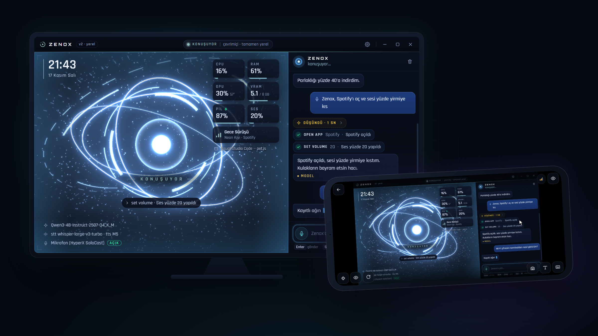
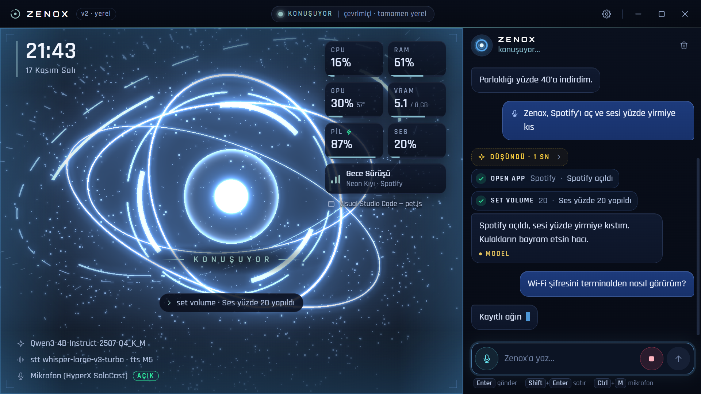
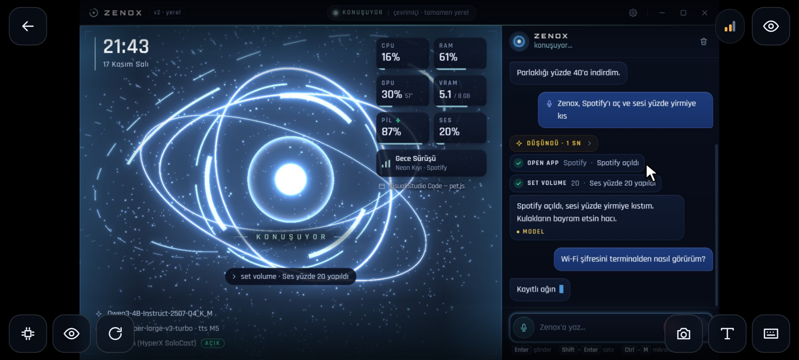
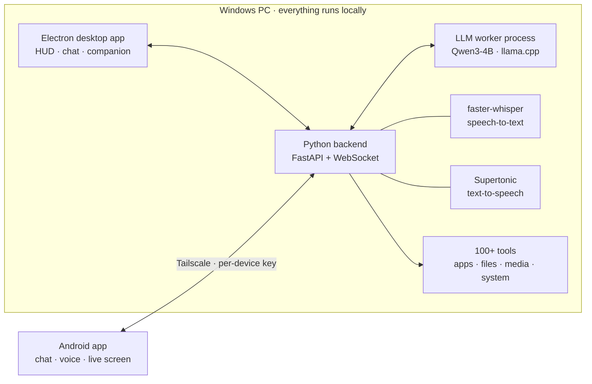

# Zenox

**A fully local, Jarvis-style personal AI assistant for Windows — voice control, desktop automation and a companion phone app. Nothing leaves the PC.**

> This is the public showcase. The source code lives in a private repository.
> [Türkçe açıklama aşağıda ↓](#türkçe)

## Highlights

- **Fully local.** The LLM (Qwen3-4B-Instruct, GGUF via llama.cpp), speech recognition (faster-whisper) and speech synthesis (Supertonic) all run on the PC. No cloud APIs, no API keys.
- **Voice first, in Turkish.** The wake word fires only when Zenox is *addressed* ("Zenox, …"), not when it is *mentioned*. Recognition tolerates mis-hearings and a lisp.
- **Hybrid brain.**
  - A rule-based intent engine handles everyday commands in about 0.1 s without the model: ~85% of a 141-command test set.
  - Everything else goes to the local LLM, which calls tools: 100+ of them for apps, files, media, volume and brightness, Wi-Fi and Bluetooth, windows, screen reading and clicking, reminders and more.
- **Desktop app.**
  - An Electron HUD with a WebGL core and live system telemetry.
  - Chat with visible tool traces, and confirmation cards before risky actions.
  - An animated desktop companion with a mini chat.
- **Phone app** (Android). All traffic goes over Tailscale with per-device keys.
  - Chat and push-to-talk; speech is recognized on the PC.
  - Live screen streaming with touch and trackpad control, plus a keyboard tray.
  - Two-way file transfer.
- **Reliability work.**
  - The LLM runs in its own worker process, with GPU offload sized to the free VRAM.
  - A backend watchdog, verified by a 28-scenario simulation.
  - Every flaky Windows API call has a time limit.

## Screenshots

| Desktop: a voice command with tool calls | Phone: live screen with touch control |
|---|---|
|  |  |

Screenshots use the real interfaces with demo data.

## Architecture

## Tech stack

Python 3.12 · FastAPI · llama-cpp-python (CUDA) · faster-whisper · Silero VAD · Supertonic (ONNX) · Electron · Three.js · Capacitor (Android) · Tailscale

It runs on a laptop with an RTX 4050 (6 GB VRAM) and 16 GB of RAM.

## Why local?

Voice, screen contents and files never leave the computer, and everything except an explicitly requested web search works offline.

## Development

This is a personal project in active development since September 2026.

---

## Türkçe

**Windows için tamamen bilgisayarda çalışan, Jarvis tarzı kişisel yapay zekâ asistanı: sesle kontrol, bilgisayarı yönetme ve telefon uygulaması. Hiçbir veri bilgisayardan çıkmaz.**

> Bu depo herkese açık vitrindir; kaynak kod gizli bir depoda durur.

- **Tamamen yerel:**
  - Dil modeli (Qwen3-4B-Instruct, llama.cpp), konuşma tanıma (faster-whisper) ve ses sentezi (Supertonic) bilgisayarda çalışır.
  - Bulut servisi ya da API anahtarı yoktur.
- **Önce ses, Türkçe:**
  - "Zenox, …" diye seslenince uyanır; Zenox'tan *bahsedilince* uyanmaz.
  - Yanlış duyulan kelimelere ve pelteklik gibi telaffuz farklarına dayanıklıdır.
- **Karma beyin:**
  - Kural motoru gündelik komutları modele sormadan yaklaşık 0,1 saniyede çözer; 141 komutluk test setinin %85'i bu yoldan gider.
  - Gerisini yerel dil modeli 100'ü aşkın araçla yapar: uygulamalar, dosyalar, medya, ses ve parlaklık, Wi-Fi ve Bluetooth, pencereler, ekranı okuyup tıklama, hatırlatıcılar…
- **Masaüstü uygulaması:**
  - WebGL çekirdekli Electron arayüzü ve canlı sistem göstergeleri.
  - Araç izlerini gösteren sohbet ve riskli işlerden önce onay kartı.
  - Mini sohbetli, hareketli masaüstü arkadaşı.
- **Telefon uygulaması (Android):**
  - Sohbet ve bas-konuş; konuşma tanıma bilgisayarda yapılır.
  - Bilgisayar ekranını canlı izleme; dokunarak, trackpad'le ve klavyeyle kontrol.
  - İki yönlü dosya aktarımı.
  - Bağlantı yalnızca Tailscale üzerinden, cihaz başına anahtarla kurulur.
- **Sağlamlık:**
  - Dil modeli ayrı bir süreçte çalışır ve boş ekran kartı belleğine göre yüklenir.
  - Backend bekçisi 28 senaryoluk bir benzetimle doğrulanmıştır.
  - Takılabilen Windows çağrılarının her birinin süre sınırı vardır.

Ekran görüntüleri gerçek arayüzlerden, örnek verilerle alınmıştır. Zenox, Eylül 2026'dan beri geliştirilen kişisel bir projedir.
